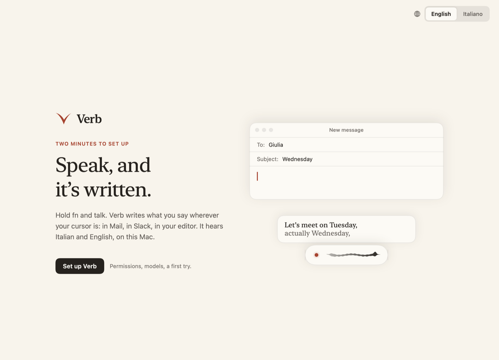
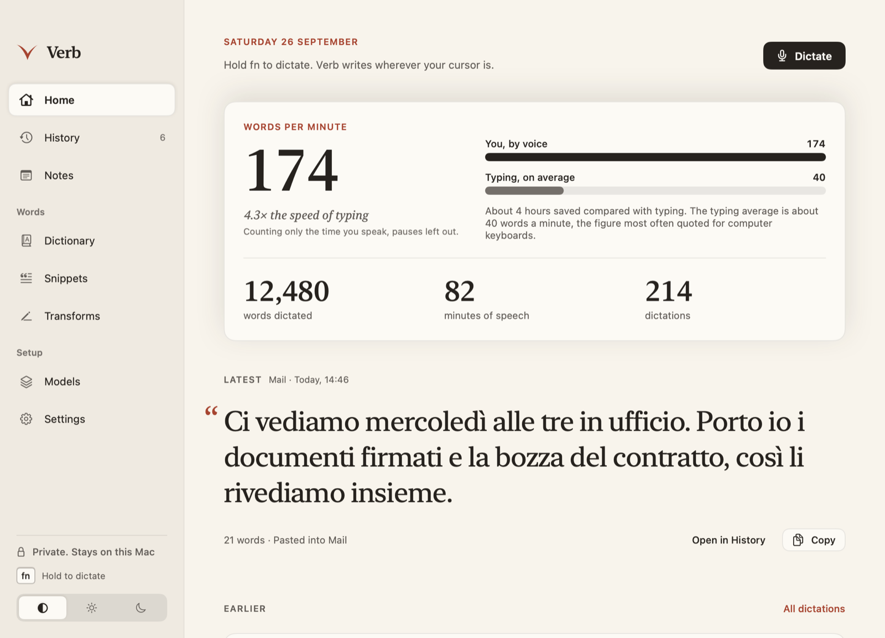
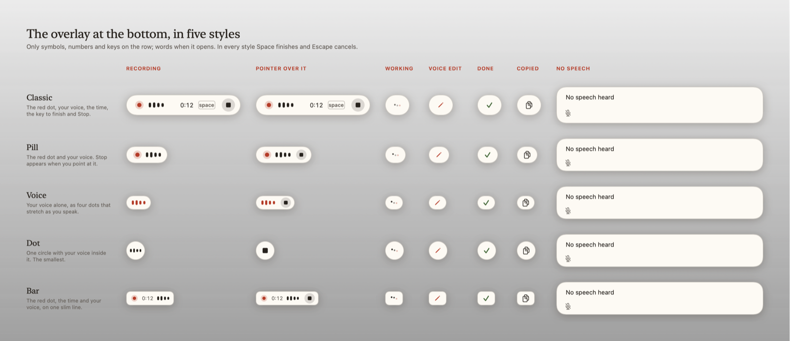
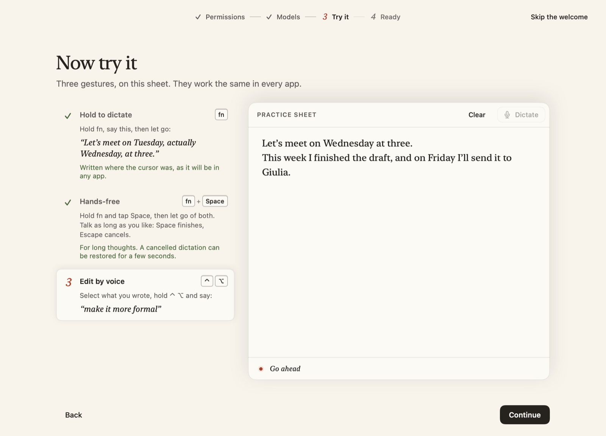
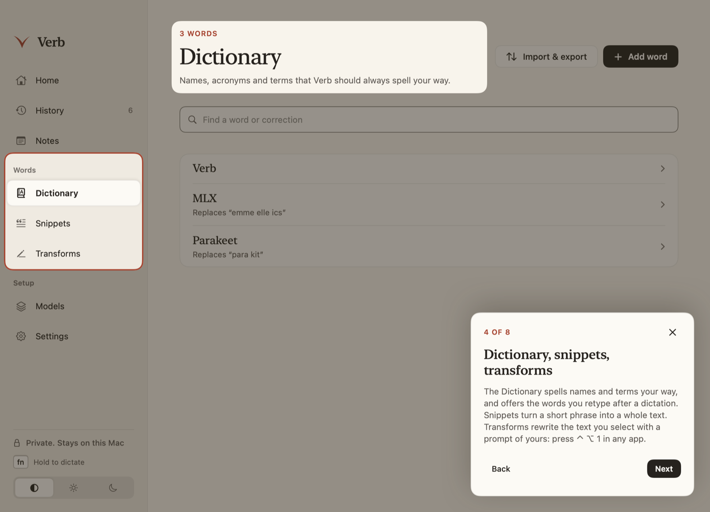

<p align="center">
  
</p>

<h1 align="center">Verb</h1>

<p align="center">
  <strong>Hold a key, speak, and your words appear wherever the cursor is.</strong><br>
  Native macOS dictation for Italian and English, running on your Mac.<br>
  MLX speech recognition, an optional local writing model, no account, no server, no telemetry.
</p>

<p align="center">
  <a href="https://github.com/MazzariniTommaso/verb/releases/latest/download/Verb.dmg"></a>
</p>

<p align="center">
  
  
  
  
  
</p>

<p align="center">
  <picture>
    <source media="(prefers-color-scheme: dark)" srcset="docs/images/welcome-dark.png">
    
  </picture>
</p>

---

**Verb** is a menu bar app. Hold **fn** in any app, talk, let go: the text is written where your cursor is, with fillers removed, your dictionary applied and the spacing fitted to the sentence around it. Say “Tuesday, actually Wednesday” and a writing model keeps only Wednesday.

Why it's worth a look if you write software:

- **Speech runs on the Mac.** [Parakeet v3](https://huggingface.co/nvidia/parakeet-tdt-0.6b-v3), [Parakeet Ultra](https://huggingface.co/moondream/parakeet-ultra) or [Qwen3-ASR](https://huggingface.co/Qwen/Qwen3-ASR-0.6B) through [MLX Audio Swift](https://github.com/Blaizzy/mlx-audio-swift) on the Apple GPU. No Python, no server, no network after the download.
- **Fast by default.** Deterministic rules clean every dictation instantly. The language model steps in only when the words call for it: a spoken correction, a list, a long passage.
- **Bring your own model.** A private [Ollama](https://ollama.com) instance, any OpenAI-compatible endpoint, or the **Claude Code, Codex, Cursor, Gemini or Copilot CLI you're already signed in to**, run in a sandbox with every tool disabled.
- **Code by voice.** In editors and terminals Verb reads the open project: “user id” becomes `userId`, “app model dot swift” becomes `AppModel.swift`, and in a terminal “tag index dot ts” becomes `@src/index.ts` for Claude Code.
- **Ask, not only dictate.** Hold **⌥⌘** and ask: the writing model answers in the overlay's box, and the next question follows on from the last. With nothing selected, the edit keys take a request: Verb writes the reply you describe where the cursor is, answers a question, or does it on the Mac (opens an app or a site, finds a file, adds a word to the dictionary).
- **Nothing gets lost.** The raw transcript is saved before any rewriting, the clipboard is always given back, and a cancelled dictation can be restored for eight seconds. One of 15 seconds or more then stays in History, ready to retry.
- **Readable codebase.** A pure-Swift core and engine with 240 tests, native SwiftUI and AppKit, a snapshot renderer for every screen, and scripted UI checks.

## Contents

- [Quick start](#quick-start)
- [Features](#features)
- [How it works](#how-it-works)
- [Development](#development)
- [Models and providers](#models-and-providers)
- [Privacy and data](#privacy-and-data)
- [Keys](#keys)
- [Performance](#performance)
- [Contributing](#contributing)
- [License](#license)

## Quick start

**Download.** Get [Verb.dmg](https://github.com/MazzariniTommaso/verb/releases/latest/download/Verb.dmg), about 10 MB, for an Apple Silicon Mac with macOS 14 or later. Open it and drag Verb to Applications. The app isn't notarized, so macOS blocks its first launch: open System Settings → Privacy & Security and click **Open Anyway**, or run

```sh
xattr -dr com.apple.quarantine /Applications/Verb.app
```

**Build from source.** You need Xcode with Swift 6.2+ and the Metal Toolchain component. If `xcrun metal --version` fails, run `xcodebuild -downloadComponent MetalToolchain`.

```sh
git clone https://github.com/MazzariniTommaso/verb.git && cd verb
bash scripts/build.sh          # builds and signs release/Verb.app (ad hoc)
open release/Verb.app
```

On first launch Verb opens a short welcome:

1. It asks for **Microphone** and **Accessibility**, then lets you test the microphone: a few seconds of speech, and whether it hears you well. Accessibility lets fn start a dictation from any app and lets Verb type into the field in front.
2. It downloads the speech model: Parakeet v3, 2.51 GB, Parakeet Ultra, 1.25 GB, or Qwen3-ASR, 713 MB. Downloads use pinned revisions, resume after a dropped connection, and check every file's size and the weights' SHA-256.
3. It offers a **writing model**. This is optional, and dictation works without one.
4. It lets you try the three gestures on a practice sheet: hold, hands-free and voice edit.
5. The last page measures your typing speed on one sentence against your voice, and can open Messages, Mail, Slack or Notes to guide your first dictation there: where to click, then when to speak.

Everything can be skipped. **Help → Take the Tour** walks through the window afterwards.

> [!NOTE]
> The build is signed ad hoc and not notarized, so macOS can ask for permissions again after a rebuild. If Accessibility is on but Verb says it's off, remove Verb from the list in System Settings and add the new build. Verb notices when it loses Accessibility: the menu bar icon shows a mark, the menu says “Keys off” and offers the fix. To keep the permissions from one build to the next, sign every build with the same certificate: set `VERB_SIGN_IDENTITY` to the name of one in your keychain, such as your Developer ID Application certificate.

To bundle the speech weights into the app instead of downloading them, point `VERB_MODEL_SOURCE` at a model root's `MLX` folder:

```sh
VERB_MODEL_SOURCE=/path/to/models/MLX bash scripts/build.sh
```

Bundled weights survive later rebuilds. `VERB_BUILD_DIR` moves the build cache.

## Features

<p align="center">
  <picture>
    <source media="(prefers-color-scheme: dark)" srcset="docs/images/home-dark.png">
    
  </picture>
</p>

**Dictation**
- **Hold fn** to talk and let go to write. **fn + Space** switches to hands-free: Space finishes, Escape cancels, and, if you choose it in Settings → Dictation, a silence of 5 to 30 seconds finishes too, its last three seconds counted down in the overlay. After 30 seconds of recording, Escape asks to be pressed again, so a stray press can't throw away a long dictation. Every shortcut can be rebound; Space and Escape keep these roles.
- **No text field in front?** When you let go, the overlay opens into a box with the text: Copy, Return or ⌃⌘C puts it on the clipboard and the box closes two seconds later; ⌃⌘V pastes it where you click next. Escape or × closes it, and the text stays as your last dictation.
- **Pressed while the last dictation is still being written**, the keys record nothing and the overlay says so. That dictation is pasted once you let go.
- **Voice start and stop.** Once you turn it on, “Hey Verb” or “Ehi Verb” starts a hands-free dictation. In any hands-free dictation, “Hey Verb stop”, “Ehi Verb invia” or “Hey Verb send” finishes it, and “Ehi Verb annulla” throws it away; a dictation held with the key ends when you let go. You can add your own names and command words.
- **Live preview.** The overlay opens to show the words as they form: below the notch, or above the capsule. They are read again four times a second, and settle at each pause, or at the quietest moment once three seconds have passed without one.
- **Long dictations are written down while you speak.** Every 28 seconds of recording is read as soon as it is there, cut exactly where the final pass would cut it, so letting go waits only for the last part: for a three-minute dictation, 0.2 s instead of 2.1 s with Parakeet v3, and 0.7 s instead of 7.5 s with Qwen3-ASR, with the same text.
- **Up to 4 hours per dictation** on the Mac. The audio is read in five-minute windows, and progress is checkpointed every minute.
- The **overlay** comes in six styles: Classic, Pill, Voice, Dot and Bar at the bottom of the screen, and **Notch** at the top. On its row it shows only symbols, numbers and keys: what is happening on the left (the red dot that breathes with your voice, the ink drops while Verb writes, a tick when it is done), how much or how on the right (the time, Stop, the key to finish). Your voice is four dots that stretch with it as you speak, drawn from the level of that moment. Words appear only when the overlay opens, as one shape: below the notch, as wide as 440 pt and over the menu bar while it lasts, or upward from the capsule, its row staying put. The answer to a question and a dictation that found no field open into a box of 440 × 253 pt, where a longer text scrolls. Pointing at a symbol opens it with what it means.
- The **notch style** hangs from the notch. Between dictations it is the notch alone: pointed at, it shows the Verb mark on one side and the dictation key on the other, and a click starts a hands-free dictation; a meeting being recorded stays beside it with its time. Closed, it never covers the menus of the app in front: Verb reads where they end with Accessibility, and when they reach the notch the left symbol moves to the right. On a display without a notch nothing shows until the pointer comes near the middle of the top edge, then a small black tab; the island follows the pointer to the screen you work on. The overlay is non-activating, so it never takes focus.
- **Music and video are turned down** while you speak, below half your volume, and come back when you stop, also after Bluetooth headphones reconnect or Verb quits. Never during a call or with VoiceOver on.
- **The microphone is chosen for you.** On Automatic, Verb takes a wired or USB microphone first (a headset in the jack, a USB headset or interface), then Bluetooth headphones, then the Mac's own, then an iPhone. Headphones hear you better than the Mac across the room, but play in call quality while you dictate; one switch puts the Mac's microphone first. Devices that pass audio between apps, as Pro Tools' or a call's, are never listed or picked. Verb opens only the microphone it uses, and a Bluetooth one only once the dictation starts, not at every press of the keys.
- **Test the microphones** in Settings → Audio: say a sentence into each, and Verb says whether it hears you clearly, with noise, too faintly or not at all, and how long it takes to open. Nothing is recorded. A microphone slow to open twice in a row, as Bluetooth headphones can be, is pointed out once a week, since the first words can be lost while it opens.
- **A microphone that changes** mid-dictation, as headphones taken off, hands over to the one Verb would pick now, in the same recording. One that keeps changing, or sends no sound at all, ends the dictation with what it has, and Verb names it.
- **Restore** brings a cancelled dictation back for eight seconds. A cancelled dictation of 15 seconds or more then stays in History, ready to retry, and so does one cut short by quitting Verb.
- **Import audio**: drop an m4a, mp3, wav or aiff file on History to transcribe it.

**Writing**
- **Instant rules** on every dictation except in the Verbatim style: hesitations (“ehm”), stumbled repeats and spacing. Words that carry meaning (“no no”, “molto molto”, “that that”) are kept, and so are acronyms in capitals (“the ER”).
- **Line breaks and punctuation by voice.** “A capo” or “new line” starts a new line, “nuovo paragrafo” or “new paragraph” a new paragraph, and “punto e a capo” ends the sentence and the line. “Virgola”, “punto interrogativo”, “punto esclamativo”, “punto e virgola”, “comma”, “question mark” and the like write their mark. Where the words mean something else they stay words: “Marco è a capo del progetto”, “il punto è”, “manca una virgola”, “add new line items”. “Punto” and “period” count only where a sentence ends.
- **Addresses by voice.** “mario punto rossi chiocciola gmail punto com” becomes mario.rossi@gmail.com, “google dot com” becomes google.com.
- **Writing model policy**: Always, When needed (the default) or Never. **A guard** rejects any clean-up that changes a number, a date, a name, a dictionary word or a negation, or that answers instead of transcribing. A spoken correction (“anzi”, “actually”) lets only its own sentence change. When the guard rejects a clean-up, Verb pastes your words as you said them. So it does when the writing model takes too long, and that model then rests for three minutes. Escape while it works skips it for that dictation.
- **Styles**: Natural, Casual, Lowercase, Formal and Verbatim, or one you describe in your own words. Lowercase, small letters and no closing full stop as in a chat with friends, needs no writing model. Each kind of place has a style: emails formal, chats with friends casual, work chats and everything else the default. An app keeps a style of its own above its kind's (Terminal verbatim, Slack in your words), and so does a **site in a browser**: Gmail in Chrome is an email, not Chrome. Verb reads the page's address through Accessibility at the start of the dictation and keeps nothing of it. A style changes tone and form, never what you said, and the guard still applies. A place with a style of its own or of its kind is refined at every dictation, even under When needed; under Never no style applies, and Settings → Styles says so.
- **About you.** A few lines in Settings → Styles, your name, role and how you sign, that every rewrite and answer reads, for names and tone, never as content to add. “Ricorda che…” or “remember that…” with the edit keys adds a line.
- **Lists and bold for each app.** When the writing model makes a list, it goes in formatted in mail and documents (Mail, Outlook, Gmail, Notes, Pages, Word, Notion, Slack), as plain lines with bullets in chats, and as written Markdown in editors, terminals, Obsidian and AI chats.
- **Fits the field.** Verb reads a little of the text around the cursor to set a space before the dictation, a lowercase letter mid-sentence and no full stop mid-phrase. Chromium and Electron apps are asked to expose their text. Apps that expose none get Verb's memory of its own last paste and of your last typed characters.
- **Dictionary** with preferred spellings and “heard as” corrections. A word the engine spelled its own way is put back when it sounds like one of yours and isn't a word of its own (“Komposio” becomes Composio, “Open AI” OpenAI); Parakeet takes no hints, so this is how it learns your words. A writing model reads only the entries the text needs, which keeps its instructions short. It learns: retype a word after a dictation, or say the same unusual name in three dictations, and Verb offers to add it. “Aggiungi al dizionario Composio” or “always spell Composio with a capital C” with the edit keys adds it at once. Nothing is added without your confirmation, and the words waiting for it stay in memory.
- **Spelled letters** become one word: “C O M P” is COMP.
- **Names from the field.** Names and identifiers already on screen become recognition hints, and a misspelling of one is put right. A real name you say, or a different number, is never swapped for one on screen. Keys, tokens and passwords are skipped, and the names reach a writing model only when it runs on this Mac.
- **English inside Italian.** English words the engine wrote the Italian way (“mercio” for merge) are put back. Names and places are left alone.
- **Snippets**: a short phrase expands to a whole text, optionally Markdown pasted as rich text. Variables include `{date}`, `{time}`, `{weekday}`, `{clipboard}` and `{cursor}`, or `{data}`, `{ora}`, `{giorno}`, `{appunti}` and `{cursore}` in Italian.

**Editing**
- **Voice edit.** Select text, hold **⌃⌥** and say “make it shorter” or “traduci in inglese”. It works in editors that hide their selection from Accessibility.
- **Ask.** Hold **⌥⌘** and ask a question: the box opens as you speak, and the answer comes word by word. Return inserts it where you were or copies it, Escape closes it; while the box is open, holding ⌥⌘ again asks a question that follows on from the ones before. With nothing selected, ⌃⌥ takes a request too. “Rispondi che giovedì alle quattro va bene” writes the reply where the cursor is, in that place's style, and a question is answered in the same box. With a writing model on this Mac, the request also reads the text near the cursor and in the window, so a reply knows what it answers; a server never gets it. Answers go to History.
- **Actions by voice**, done on the Mac without a model: “apri Slack”, “vai su repubblica.it”, “cerca il file preventivo Rossi” (Spotlight, the files in the box), “cerca su Google…”, “nuova nota”, “registra la riunione”, “termina la riunione”. Nothing runs scripts or touches other apps' data.
- **Transforms** are saved prompts on **⌃⌥1–9**, with any number of extra ones in the menu bar. A voice edit or a transform takes up to 3,000 words with the writing model on this Mac and 12,000 with a server or a subscription, and the model gets room for an answer as long as the text.

**Notes and meetings**
- **Notepad** on **⌃⌥N**, floating over every app. You dictate into it like any field, and into Verb's own fields too: a search, a dictionary word, a snippet, a prompt. Notes are Markdown files, in any folder you choose, including iCloud Drive or an Obsidian vault.
- **Meeting notes** record your microphone and what the Mac plays, through a Core Audio process tap (macOS 14.2+). No bot joins the call, and the recordings and the transcript stay on the Mac. The result is a transcript with You and Others, in the language spoken, then a summary from your writing model: In short, Decisions, Next steps and My to-dos. The summary is only sent out if that model is remote and remote processing is allowed when it's written. A meeting cut short by a quit is written down at the next launch, and its recordings expire like the others. One that can't be written down keeps its recordings and waits in Notes, with Retry and Delete.
- **Calls are noticed.** When Zoom, Teams, Webex, FaceTime, Slack or a Meet tab keeps the microphone for a few seconds, the overlay offers to record the call; when the app lets the microphone go, it asks whether to stop and write the notes. Verb only checks which apps use the microphone, on the Mac; it can be turned off in Settings → Meetings.
- **Kinds of notes**: general, one-on-one, stand-up, client call, interview, lesson, or kinds you describe. While the meeting records, the notes you type beside it guide the summary and are kept in the note. A note shares through the system menu (Mail, Messages, AirDrop) and exports to Word.

**App**
- **History** with search, original and final text, playback, retry and export; Home's “Open in History” opens that very dictation. **Home** greets you by the time of day and shows your words per minute counted on voiced time only, against your own typing speed once the welcome measured it, your week against the one before, your streaks, a 15-week heatmap and your top apps.
- **The first days.** Hold another key alone for a moment twice, as if to dictate, and the overlay says which keys dictate. Type a long text by hand and Verb suggests saying it, once a day for three days. Someone who has dictated for a while gets neither.
- **Report a problem** from Settings → General or the Help menu: what happened in your words, with Verb's version, the Mac's model and how Verb is set up, and optionally the last half hour of Verb's log. Never your words, dictionary or keys. It opens as a new GitHub issue, which you read before sending, or saves as a file.
- **The menu bar icon** moves anywhere in the menu bar with ⌘-drag, and keeps its place from one launch to the next.
- **Memory control.** The models unload after 30 minutes idle (configurable), and live RAM and CPU are shown.
- **Settings** in nine short pages: General, Dictation, Audio, Keyboard, Voice, Styles, Meetings, Privacy and Advanced. Each setting says what it does in a line; the pointer over it says more.
- **English or Italian interface**, and Light, Dark or Automatic appearance, all switchable live. VoiceOver labels and announcements, Reduce Motion, Increase Contrast, 44 pt hit areas for buttons, and every page usable at the smallest window, 720 × 560, half of a 14-inch MacBook's screen, so it tiles beside another app. The window grows to 1600 × 1200 and a page only gains from it: its margins step from 32 to 56 pt, its column starts by the sidebar and keeps a readable measure, and in a large window Home sets its cards side by side. In a small one, settings put their controls under their labels and the sections in a menu. ⌃⌘S, or the button by the logo, keeps only the sidebar's icons, in a rail centred under the window's buttons. The notepad goes from 480 × 340, showing the list or the note, to 1200 × 1000.

<p align="center"></p>

## How it works

```
fn held ──▶ Hotkeys (CGEventTap; Carbon hot keys for combos)
              │
              ▼
          Recorder (MicrophoneInput: the chosen device's own input unit → 16 kHz mono) ──▶ VoiceActivity (utterances, "Ehi Verb")
              │
              ▼
          LocalSpeech (MLX: Parakeet v3 / Qwen3-ASR)     raw transcript saved to History first
              │
              ▼
          TextRules · dictionary · VocabularyMatch · snippets · CodeSpeech · EnglishTerms · FieldTerms
              │                                          writing model only when needed; a request goes to Assistant
              ▼
          ModelClient (Ollama :11435 / endpoint) · HarnessClient (CLI subscriptions)
              │                                          CleanupGuard: meaning kept or rewrite dropped
              ▼
          FieldFormatting (text around the cursor) ──▶ TextInserter (lazy pasteboard + ⌘V, clipboard restored)
```

The package has five targets: four in Swift, and `CSQLite`, which links the system SQLite. The app and `verb-check` depend on `VerbCore` and `VerbEngine`.

| Target | What lives there |
|---|---|
| `VerbCore` | Pure Swift, no UI and no audio. Settings and records, text rules, voice commands and voice activity, field formatting, cleanup guard, code speech, snippets, notes, SQLite storage, provider policy. Almost every test targets this. |
| `VerbEngine` | Model runtimes and child processes: MLX speech loading and download, chunked PCM reading, the microphone read straight from Core Audio, the HTTP client for Ollama and endpoints, and the sandboxed CLI bridge for subscriptions. |
| `Verb` | The app: SwiftUI and AppKit UI, menu bar, overlay, hotkeys, text insertion, recorder, meeting recorder, onboarding and tour, snapshot renderer, diagnostics. |
| `VerbCheck` | `verb-check`, a command-line tool that runs the engines without the app. |
| `CSQLite` | The module map for the SQLite that macOS supplies. |

Start reading here:

| File | Why |
|---|---|
| `Sources/Verb/AppModel.swift` | The state machine: authorize, record, transcribe, polish, insert. It also owns settings, history and the voice-activation loop. |
| `Sources/Verb/Hotkeys.swift` | Modifier-only bindings (fn, ⌃⌥, ⌥⌘), Space to go hands-free, Escape. |
| `Sources/Verb/TextInsertion.swift` | Capturing the target field, the Accessibility checks, the lazy pasteboard, clipboard restore. |
| `Sources/VerbCore/TextRules.swift` | Fillers, repeats, dictionary corrections, snippet protection. |
| `Sources/VerbCore/FieldText.swift` | Fitting to the field, and the correction learner. |
| `Sources/VerbCore/VoiceCommands.swift` | Wake and stop phrases, matched against the spellings the engine actually writes. |
| `Sources/Verb/AskFlow.swift` | Requests made with nothing selected: the actions Verb does itself, and the answers and drafts from the writing model. |
| `Sources/VerbEngine/HarnessClient.swift` | Claude Code, Codex, Cursor, Gemini and Copilot adapters. |
| `Sources/Verb/Theme.swift` | The UI components. Every value comes from the generated `DesignTokens.swift`. |

## Development

```sh
bash scripts/build.sh                    # release/Verb.app, signed ad hoc
swift test                               # 240 tests: VerbCoreTests and VerbEngineTests
swift build -c release --product verb-check
bash scripts/package.sh                  # release/Verb.dmg to share, about 10 MB
```

`scripts/build.sh` refuses to run while Verb is open, because macOS kills an app whose binary changes underneath it. Quit it first:

```sh
osascript -e 'tell application id "app.verb.dictation" to quit'
```

**Share a build.** `scripts/package.sh` packs `release/Verb.app` into a disk image with a link to Applications. It leaves the speech weights out, so the welcome downloads the model on the other Mac. That Mac needs Apple Silicon and macOS 14 or later. Signed ad hoc, the app is blocked on its first launch there: allow it in System Settings → Privacy & Security → **Open Anyway**, or run `xattr -dr com.apple.quarantine /Applications/Verb.app`.

With a Developer ID, the script signs the app and the image with it, has Apple notarize both and staples the tickets, so Verb opens on any Mac without a warning, even offline. Save your notarization credentials once, then name the certificate and the profile:

```sh
xcrun notarytool store-credentials verb-notary      # asks for your Apple ID, team ID and an app-specific password
VERB_SIGN_IDENTITY="Developer ID Application: Your Name (TEAMID)" VERB_NOTARY_PROFILE=verb-notary bash scripts/package.sh
```

**See every screen without clicking.** The app binary renders every page, sheet and overlay state in both languages and both appearances, from a throwaway profile. It never starts the microphone, a hotkey or a model:

```sh
.build/release/Verb --render-snapshots /tmp/verb-renders                         # everything, including every page from 720 × 560 to 1600 × 1200
.build/release/Verb --render-snapshots /tmp/verb-renders --only welcome,tour     # by name prefix, about 1 minute
```

**Diagnostics and scripted checks.** These run from the app executable, `.build/release/Verb` or `release/Verb.app/Contents/MacOS/Verb`. The two that use Accessibility need the app itself, so macOS asks on its behalf rather than the terminal's; each flag stops if its path is missing:

| Flag | Does |
|---|---|
| `--check-welcome FILE` | Walks the welcome and the tour in an off-screen window: practice sheet focus, gesture ticks, every tour target, persistence. |
| `--check-window FILE` | Checks the main window's and the notepad's smallest and largest sizes in invisible windows: a size too large or too small comes back within them, and the green button makes them as large as they may be. |
| `--check-notepad FILE` | Checks the floating notepad's window behaviour. Run it with `open -n -g release/Verb.app --args --check-notepad FILE`. |
| `--measure-frames FILE` | Measures how often the overlay's voice dots are redrawn. Unlock the screen first. |
| `--probe-fields FILE [--wake]` | Reports what each open app exposes to Accessibility about its focused field. It records flags and sizes, never text. Run it with `open -n -g release/Verb.app --args --probe-fields FILE`. |
| `--data-dir PATH` | Uses an isolated profile instead of `~/Library/Application Support/Verb`, with its own Keychain entries. |
| `--background` | Starts in the menu bar, as a login item does. |
| `--welcome` | Opens the welcome at launch. |

**Engines without the app.** `MODEL_ROOT` holds an `MLX` folder with one folder per model, just as `Contents/Resources/MLXModels` does inside the app.

```sh
.build/release/verb-check install MODEL_ROOT parakeet-v3
.build/release/verb-check transcribe MODEL_ROOT Tests/Fixtures/italian.aiff auto parakeet-v3
.build/release/verb-check transcribe MODEL_ROOT Tests/Fixtures/english.aiff auto parakeet-v3
.build/release/verb-check listen MODEL_ROOT /tmp/wake.aiff          # wake and stop phrases, the app's own path
.build/release/verb-check memory MODEL_ROOT Tests/Fixtures/italian.aiff parakeet-v3   # memory with the model loaded, after a dictation and once it is let go
.build/release/verb-check ahead MODEL_ROOT /tmp/long.wav parakeet-v3   # written down part by part, as while it records: the wait left at the end, and the same text
.build/release/verb-check ask "Rispondi che va bene giovedì"        # a request to the local writing model, or the action it names
.build/release/verb-check microphone BuiltInMicrophoneDevice 3     # opens a microphone as Verb does: format, start time, sound, headphones' sound kept
.build/release/verb-check cleanup 'Ci vediamo martedì, anzi mercoledì.'   # needs Verb's Ollama running
.build/release/verb-check evaluate-cleanup                          # the clean-up cases against the local writing model
.build/release/verb-check harness-list claude                      # model catalog only
.build/release/verb-check harness-edit claude haiku "Ehm, il gatto è sul divano, anzi sulla sedia."   # uses plan quota
python3 Tests/Fixtures/provider_fixture.py &                       # a fake endpoint on :11436
.build/release/verb-check verify-endpoint http://127.0.0.1:11436 Tests/Fixtures/italian.aiff
```

To make a wake-phrase recording: `say -v Alice -o /tmp/wake.aiff "Ehi Verb. [[slnc 1000]] Ci vediamo alle tre. [[slnc 1000]] Ehi Verb stop."`

**Compare speech models.** The benchmark runs any MLX speech model on this Mac over the same clips in up to 24 languages, and picks three: the default, which detects the language within a latency and memory budget; the most accurate; and the fastest close to it.

- **The clips.** `scripts/fetch-speech-benchmark.py` builds the set from [FLEURS](https://huggingface.co/datasets/google/fleurs), read sentences under CC BY 4.0, pinned to one commit. It streams each language's archive and stops once it has enough clips. It adds long clips of six sentences in a row, which exercise chunking, and silence and noise, where the right transcript is empty.
- **The models.** `Benchmarks/speech-models.json` lists the candidates, each pinned to a commit with the languages it claims. `speech-bench` installs each into `~/Library/Caches/Verb/SpeechModels`, checking every file against the hash Hugging Face publishes, and fetches only weights, configs and tokenizers.
- **The runs.** Each model hears every clip in its languages: with the language given and, when it can detect it, without, as Verb's Automatic setting works. One JSON line per clip goes to the results file, so runs from different days or Macs can be combined.
- **The scores.** As on the public leaderboards, case and punctuation are dropped, and Chinese, Japanese and Korean are scored by character. Spoken numbers become digits in English, Italian, Spanish, French, German and Portuguese, so "quindici" and "15" count alike. A second score keeps case and punctuation, as a dictation is inserted.

```sh
python3 scripts/fetch-speech-benchmark.py                    # 24 languages, 80 sentences each, about 1 GB to download
.build/release/verb-check speech-bench ~/Library/Caches/Verb/SpeechBenchmark/manifest.jsonl Benchmarks/speech-models.json /tmp/speech.jsonl --only parakeet-v3,parakeet-ultra
.build/release/verb-check speech-bench-report /tmp/speech.jsonl --weights it=2,en=2 --latency 1.0 --memory 3
.build/release/verb-check speech-install mlx-community/whisper-large-v3-turbo /tmp/whisper     # any MLX speech model, for a first look
.build/release/verb-check speech-transcribe /tmp/whisper Tests/Fixtures/italian.aiff it
```

`speech-bench` also takes `--languages it,en`, `--limit N` sentences per language, `--kinds speech,long,nonspeech` and `--modes hint,auto`. A quick pass with `--limit 20` takes minutes; the full set takes hours for the slower models.

**Design tokens.** Colours, type, spacing, radii and motion live in `Design/tokens.json`. Regenerate after editing it:

```sh
python3 scripts/generate-tokens.py      # writes Sources/Verb/DesignTokens.swift and Design/tokens.css, checks WCAG contrast
swift scripts/make-icon.swift /tmp/Verb.iconset && iconutil -c icns /tmp/Verb.iconset -o Resources/Verb.icns
```

**Two languages, side by side.** Every UI string is written as `t("English", "Italiano")` at the call site. Messages coming from `VerbCore` and `VerbEngine` stay in English and are translated in `Sources/Verb/Italian.swift`.

Read [CONTRIBUTING.md](CONTRIBUTING.md) before opening a pull request. Coding agents should read [AGENTS.md](AGENTS.md).

<p align="center"></p>

## Models and providers

**Speech recognition** runs on the Mac by default:

| Model | ID | Download | Notes |
|---|---|---|---|
| [Parakeet v3](https://huggingface.co/mlx-community/parakeet-tdt-0.6b-v3) | `parakeet-v3` | 2.51 GB | Default. Multilingual, with automatic language detection. |
| [Qwen3-ASR 0.6B 4-bit](https://huggingface.co/mlx-community/Qwen3-ASR-0.6B-4bit) | `qwen3-asr-0.6b-4bit` | 713 MB | Compact. Takes language and vocabulary hints. |
| [Parakeet Ultra](https://huggingface.co/selcukkubur/parakeet-ultra-mlx) | `parakeet-ultra` | 1.25 GB | Moondream's Parakeet, the same architecture and 25 languages as v3, at half the download. |

Audio is downmixed to 16 kHz and cut into segments of at most 28 s near quiet points. A hosted speech endpoint also works: multipart `file`, `model`, `language` and `prompt` in, JSON `text` out. It is limited to 20 minutes per dictation; recordings over 10 MB, or in a format the service may refuse, are converted to m4a first.

**Writing and cleanup** is optional:

| Provider | How |
|---|---|
| On this Mac | Verb starts the installed Ollama on `127.0.0.1:11435` with `OLLAMA_NO_CLOUD=1` and its own model folder. It never touches your normal Ollama on 11434. The default model is `qwen3:4b-instruct-2507-q4_K_M`, 2.5 GB. `qwen3:1.7b` is quicker. |
| My subscriptions | The Claude Code, Codex, Cursor Agent, Gemini or GitHub Copilot CLI, with the login you already have. See below. |
| Hosted or custom server | Any Chat Completions endpoint, OpenAI's reasoning models included. Loopback HTTP is allowed; a `-cloud` model on a loopback Ollama runs remotely, so it needs **Allow remote processing**, like anything that isn't loopback, which also requires HTTPS. |
| None | Rules, dictionary and snippets only. Voice edits and transforms need a model. |

**Subscriptions, safely.** Verb launches the CLI directly, with no shell, and passes the text over stdin, the protocol or a private file, never in `argv`:

- Each call runs in a temporary directory, with an allowlisted environment, a deadline and bounded output. A cancel or a timeout stops the CLI and anything it started.
- Reading your account and the model list reaches the provider too, so it also waits for **Allow remote processing**.
- Tools, MCP, hooks, web access and file access are disabled or denied for every provider.
- API-key environment variables and endpoint overrides are stripped, and API-key logins are refused. Claude and Codex must use a subscription login, Gemini Google OAuth, and Cursor a non-API login.
- Verb never reads OAuth tokens. Each CLI authenticates itself. Model catalogs come from the CLI, never from a hardcoded list.
- Remote processing is off in a fresh profile. There's no fallback to another provider or to API billing. A failed clean-up keeps the original transcript.

These calls count against your plan's limits.

| Provider | Log in | Catalog |
|---|---|---|
| Claude Code | `claude auth login` | CLI initialize response |
| Codex | `codex login` (ChatGPT) | app-server `model/list` |
| Cursor Agent | `agent login` | `agent --list-models` |
| Gemini CLI | `gemini` (Google login) | ACP session models |
| GitHub Copilot | `copilot login` | headless `models.list` |

## Privacy and data

- **Nothing leaves the Mac** unless you choose a remote provider and turn on **Allow remote processing**. What is sent is then exactly what that stage needs: audio to speech, text and your dictionary to writing, the selection for an explicit edit, and a request's own words. Names read from the field, and the text near the cursor and on screen that a request reads, stay on the Mac.
- **No analytics, no account, no screenshots.** API keys go to the Keychain, never to `settings.json`.
- **What Verb reads.** When a dictation starts, Verb reads the text around the cursor and the window title: up to 3,000 characters before and 800 after for name hints, 400 and 80 for spacing. Nothing is kept beyond that dictation, and both can be turned off in Settings → Advanced. Words you retype after a dictation wait as suggestions in memory; one you turn down is remembered only as a digest. It reads the selection only for a voice edit or a transform. In a browser it reads the page's address at the start of a dictation, for the site's style, and keeps nothing of it. A request made with nothing selected reads the window's text, at most 6,000 characters, only for a writing model on this Mac, and only that once. To notice calls, Verb checks which apps use the microphone, by their identifier, never what they hear. To suggest dictating, it counts the characters you type in the app in front over the last minute, never which. Where an app exposes no text, it remembers the last characters you typed there, at most 40 and in memory only, until a click, an arrow key, a shortcut or an app switch. Password fields hide their keys from every app, and nothing is read or pasted in password managers (1Password, Passwords, Keychain Access, Bitwarden, KeePassXC, LastPass, Enpass).
- **“Hey Verb”**, when you turn it on, keeps the last 12 seconds of audio in memory and checks each utterance on the Mac. Nothing is written or sent until it hears the phrase. The orange microphone light stays on while it listens.
- **The clipboard stays yours.** The text is handed to the target app only when it asks. What you had copied is back a quarter of a second after the app's last read, half a second after the paste at the soonest. An app that doesn't read it within a second is said not to have taken it; the text stays on the clipboard for ten seconds in case it is only slow. Clipboard managers are told the pasted item, and the one put back, are transient. A password put back is cleared again after 90 seconds, as password managers do.

Everything lives in `~/Library/Application Support/Verb/`. The folder, and every recording and note in it, is readable by your user only:

| Path | Contents |
|---|---|
| `history.sqlite` | Dictation history and recovery journal. It keeps 30 days by default, adjustable from 24 hours to forever, or not kept at all. A shorter setting, or turning audio off, says how much it would delete and asks first. |
| `Audio/` | Recordings for playback and retry. They expire after 14 days, or sooner under the history setting. With audio off, only a dictation that failed keeps its recording, for Retry. |
| `settings.json` · `library.json` · `stats.json` | Preferences · dictionary, snippets and transforms · totals |
| `Notes/` · `Meetings/` | Markdown notes · meeting recordings, which expire like the others and are kept only if you keep audio |
| `Models/MLX/` · `WriterModels/` | Downloaded speech weights · Verb's own Ollama models |
| `harness-catalogs.json` | Cached CLI model catalogs. It holds no tokens and no email. |
| `writer.pid` | The process number of Verb's own Ollama, so one left by a crash is stopped. |
| `*.unreadable` | A settings or library file with a value Verb couldn't read, kept as it was; the rest was loaded. |

## Keys

| Action | Default |
|---|---|
| Dictate | hold **fn** |
| Go hands-free | **Space** while holding fn, then **Space** to finish and **Escape** to cancel |
| Edit the selection by voice, or ask with nothing selected | hold **⌃⌥**, then speak |
| Ask a question, answered in the overlay's box | hold **⌥⌘**, then speak |
| Run a transform on the selection | **⌃⌥1** … **⌃⌥9** |
| Paste the last dictation | **⌃⌘V** |
| Copy the last dictation | **⌃⌘C** |
| Open or close the notepad | **⌃⌥N** |
| Hands-free with one press | none until you choose keys in Settings → Keyboard |
| Go to a page of the window | **⌘1** … **⌘8** |
| Keep only the sidebar's icons, or show it whole | **⌃⌘S** |
| Start or stop by voice | “Ehi Verb” … “Ehi Verb stop” (Settings → Voice) |

You can rebind every shortcut in Settings → Keyboard, and each transform on the Transforms page; Space and Escape keep their roles, and Space can't be part of the keys you hold. The keys window refuses keys macOS uses for its own shortcuts and names well-known apps that use the ones you pick. If fn opens the emoji picker or macOS Dictation, the practice page says so: pick other keys or set “Press 🌐 key to” to “Do Nothing” in System Settings → Keyboard. Some external keyboards don't send fn at all.

While VoiceOver runs, ⌃⌥ held belongs to it: voice edit on ⌃⌥ waits until you choose other keys. When an app holds secure input, as a password field or Terminal's Secure Keyboard Entry does, no key reaches Verb; the menu names the app. Keyboard layouts that move V and C, such as Dvorak, paste and copy with the keys that type them.

<p align="center"></p>

## Performance

These were measured on an M4 MacBook Pro running macOS 27.

- **Speech:** a 9 min 43 s recording was transcribed in 7.6 s with Parakeet v3. Written down part by part while it records, a 2 min 49 s dictation leaves 0.20 s of work after the keys come up, against 2.12 s for the whole, with the same text; with Qwen3-ASR, 0.73 s against 7.45 s.
- **Requests**, Qwen3 4B loaded: a short reply in 0.6 s, and an answer's first words in under 0.6 s while the rest streams into the box.
- **Writing model**, Qwen3 4B loaded: 0.4 s for 7 words, 1.5 s for 30 words, 2.4 s for 46 words, and about 4 s on a cold load. The same edits through the Claude CLI took 6 to 31 s.
- **Wake phrase,** tested through `verb-check listen` with the macOS voices:
  - 17 of 20 “Ehi Verb” phrases started a dictation;
  - 15 of 17 endings stopped it;
  - 16 of 17 final texts came out without the commands;
  - none of 26 near-miss sentences (“A verb describes an action”, “Ehi, verbale approvato?”) woke it.

Numbers from other Macs are very welcome. Open an issue with yours.

## Contributing

Pull requests are welcome, whether they fix a bug, tune a heuristic, add a test or polish the UI. Some places where help goes a long way:

- **Apps where insertion or field fitting misbehaves.** Attach the `--probe-fields` output, which contains no text.
- **Spellings the engine writes** for your “Ehi Verb”, and the tests that go with them in `VoiceTests.swift`.
- **Rules and guards** in `VerbCore`, which are pure functions with fast tests.
- **Measurements** on M1, M2 and M3 Macs, and on older macOS versions.

Start with [CONTRIBUTING.md](CONTRIBUTING.md). It covers setup, conventions, the checks to run and the invariants no change may break.

## License

The code is released under the [MIT License](LICENSE).

The speech weights and third-party packages keep their own licenses. Parakeet v3 and Parakeet Ultra are CC BY 4.0, Qwen3-ASR is Apache 2.0, and MLX, MLX Audio Swift and the Swift packages are MIT or Apache 2.0. They are listed in [`Resources/Licenses`](Resources/Licenses), and that folder ships inside the app. See [`Resources/Licenses/MODELS.md`](Resources/Licenses/MODELS.md) for attribution.

Built on [MLX Swift](https://github.com/ml-explore/mlx-swift), [MLX Audio Swift](https://github.com/Blaizzy/mlx-audio-swift), NVIDIA's [Parakeet](https://huggingface.co/nvidia/parakeet-tdt-0.6b-v3), Qwen's [Qwen3-ASR](https://huggingface.co/Qwen/Qwen3-ASR-0.6B) and [Ollama](https://ollama.com).
